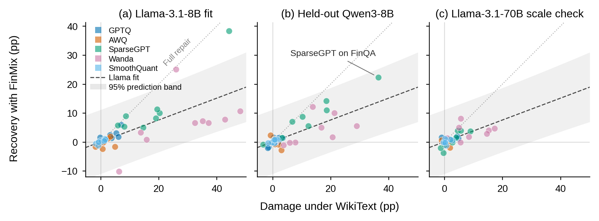

# Financial LLM Compression & Calibration

**Damage Predicts Recovery: When Calibration Data Matters in Compressing Financial LLMs** (ICAIF '26)
Junyi Ye, Mengjia Yu, Debapriya Hazra, Guiling Wang · [paper PDF](paper/Damage-Predicts-Recovery_ICAIF26.pdf) · [doi:10.1145/3858063.3858724](https://doi.org/10.1145/3858063.3858724) · [models on Hugging Face](https://huggingface.co/collections/jy395/financial-llm-compression-and-calibration-icaif-2026)

This repo contains the code and data behind the paper. It studies when
post-training compression of financial LLMs needs domain-matched calibration
data, and shows that the answer depends on the *task-level damage* the
compression causes — not on domain mismatch.

## Why this paper

Quantization and pruning compress a trained LLM using only a small calibration
corpus. In practice that corpus is generic text (WikiText, C4), even when the
model will be deployed in a specialized domain like finance. Whether
domain-matched calibration helps has been unsettled: prior results range from
substantial gains to no effect. Practitioners lack a rule for deciding when
specialized calibration data is worth constructing.

We test this in a controlled study: two model families plus a scale check
(Llama-3.1-8B main, Qwen3-8B out-of-sample, Llama-3.1-70B), six compression
configurations (RTN, GPTQ, AWQ, SmoothQuant, SparseGPT, Wanda), three
token-matched calibration corpora (WikiText, C4, and **FinMix** — a mixture of
financial task examples), and ten financial tasks spanning classification and
numerical question answering. Every compressed model is compared against its
own BF16 reference on identical test samples with paired statistical tests;
free-form numerical answers are scored by a human-validated LLM judge.

What we find:

- **Quantization barely damages, so calibration barely matters there.**
  4-bit weight quantization leaves most tasks within noise of BF16, and
  switching the calibration corpus has little effect.
- **Pruning damages numerical reasoning, selectively.** 50% sparsity removes
  up to 41 accuracy points on FinQA/ConvFinQA/TAT-QA while classification
  tasks move little.
- **Where damage is large, FinMix repairs part of it.** Under pruning,
  calibrating on FinMix instead of WikiText recovers roughly 20–60% of the
  lost numerical-QA accuracy; it also repairs GPTQ's smaller FinQA loss.
  Swapping one generic corpus for another (C4 in place of WikiText) changes
  nothing — the gain comes from domain match, not from changing corpora. And
  only methods that reconstruct weights from calibration activations (GPTQ,
  SparseGPT, Wanda) show the repair; AWQ and SmoothQuant do not.
- **Damage predicts recovery across families and scales.** The relationship,
  fitted on Llama-3.1-8B, correctly predicted the largest repair out-of-sample
  on Qwen3-8B; at 70B, damage shrinks and calibration differences fall within
  noise.

So specialized calibration data is a conditional investment: **measure
task-specific compression damage first, and construct it only when the damage
is large.**

<p align="center">
  
</p>

One point per (model, method, task): x is the damage under generic WikiText
calibration, y is the recovery from switching to FinMix. Undamaged
configurations gain nothing; damaged ones recover in proportion to what they
lost. The black-ringed points are an out-of-sample test of that relationship:
the trend was fitted on Llama-3.1-8B alone and used to predict, before the
runs were executed, that Qwen3-8B under SparseGPT would recover strongly —
the ringed points show that prediction borne out.

## Quick start

```bash
pip install -r requirements.txt

# 1. Compress: GPTQ W4A16, calibrated on FinMix (writes data/models/...-gptq-w4a16-c3)
python scripts/quantization/gptq_w4a16.py --calib-path data/calibration_datasets/c3_finmix.jsonl

# 2. Evaluate the compressed model on FinQA (full test set, included in data/)
python scripts/evaluation/eval_t5_finqa.py \
    --model data/models/Meta-Llama-3.1-8B-Instruct-gptq-w4a16-c3 \
    --output results/gptq_c3_t5.json

# 3. Score the free-form numerical answers with the LLM judge
export DEEPSEEK_API_KEY=...
python scripts/llm_judgement/adjudicate_t5_finqa.py --input results/gptq_c3_t5_detailed.json
```

Run everything from the repo root. Scripts use the GPU in
`CUDA_VISIBLE_DEVICES` (default 0); the 8B models need one 80GB-class GPU, the
70B runs need two. The paper runs used PyTorch 2.x, transformers 4.57 and
llm-compressor ≥0.10 on H200s.

## What's inside

```text
paper/                        camera-ready PDF and the damage–recovery figure
data/calibration_datasets/    WikiText (c1), C4 (c2) and FinMix (c3) corpora and
                              seed variants — the exact files used
data/evaluation_datasets/     test sets for the ten tasks, exactly as evaluated
scripts/quantization/         one script per method (GPTQ/AWQ/RTN/SmoothQuant/
                              SparseGPT/Wanda) + sweep pipelines + corpus preparation
scripts/calibration/          construction of FinMix (one prep script per task + merge)
scripts/evaluation/           eval_t1 … eval_t10, one per task, + per-model sweep runners
scripts/llm_judgement/        LLM-judge adjudication of FinQA/ConvFinQA/TAT-QA
                              outputs + error attribution
scripts/analysis/             paired significance tests, damage/recovery figure,
                              perplexity evaluation
```

Tasks are numbered T1–T10: FPB sentiment, FOMC, Headlines, CFA, FinQA, FinRED,
FinCausal, ConvFinQA, BigData22, TAT-QA. Calibration sets keep their config
prefixes (`c1` = WikiText, `c2` = C4, `c3` = FinMix) because compressed-model
directories and result files are named after them.

## Released data & models

- All 30 compressed models of the paper grid (RTN/GPTQ/AWQ/SmoothQuant/
  SparseGPT/Wanda × WikiText/C4/FinMix, for Llama-3.1-8B/70B-Instruct and
  Qwen3-8B) are on Hugging Face:
  [Financial LLM Compression & Calibration (ICAIF 2026)](https://huggingface.co/collections/jy395/financial-llm-compression-and-calibration-icaif-2026).
  Each model card states its method, calibration corpus and the exact script
  that produced it; download one into `data/models/` and the evaluation
  scripts pick it up unchanged.
- All evaluation results of the paper grid (summary metrics, per-sample
  records, and the DeepSeek judge verdicts for FinQA/ConvFinQA/TAT-QA) are on
  Hugging Face as a dataset:
  [financial-llm-compression-calibration-results](https://huggingface.co/datasets/jy395/financial-llm-compression-calibration-results).
  Download it into `experiments/` and the analysis scripts reproduce every
  table, figure and significance test with no GPU or judge-API cost.
- `data/calibration_datasets/` holds the exact calibration corpora: WikiText
  and C4 each provide 128 × 2048 = 262k tokens, FinMix ~260k tokens over 2042
  task-formatted prompts, and every configuration consumes its corpus in full,
  so all contrasts compare matched budgets. Per-task composition and the
  seed-variant files are documented in
  [its README](data/calibration_datasets/README.md).
- `data/evaluation_datasets/` holds the ten test sets exactly as evaluated
  (deduplicated where the public releases contain duplicates), redistributed
  from FLARE/PIXIU, FinBen, FinGPT and FinEval for exact reproducibility —
  see [its README](data/evaluation_datasets/README.md).

## Reproducing a specific result

The pipeline runs in four stages, in the order the paper's tables need them:

1. **Compress** (`scripts/quantization/`). Each method script takes
   `--calib-path` and writes the compressed model to `data/models/`. One sweep
   per model covers the paper's grid: `run_llama8b_quantize_all.sh`,
   `run_qwen3_8b_quantize_all.sh` and `run_llama70b_quantize_all.sh`, plus
   `run_gptq_seed_robustness.sh` (both corpora rebuilt under seeds 43/44).
2. **Evaluate** (`scripts/evaluation/`). `eval_t<N>_<task>.py` evaluates one
   model on one task and writes a metrics JSON plus a `_detailed.json` with
   per-sample outputs. `run_llama8b_all_tasks.sh` sweeps the full 8B paper
   grid (optionally one task: `... run_llama8b_all_tasks.sh t5`);
   `run_llama70b_all_tasks.sh` covers the 70B appendix grid; and
   `run_qwen3_8b_all_tasks.sh` runs the Qwen3-8B transfer (including the
   out-of-sample SparseGPT prediction). The sweeps follow the paper protocol:
   tasks with large test pools (T3/T6/T7/T10) are capped at 1500 samples
   (deterministic seed-42 selection; see `data/evaluation_datasets/README.md`),
   the rest use the full test set.
3. **Adjudicate** (`scripts/llm_judgement/`). FinQA (t5), ConvFinQA (t8) and
   TAT-QA (t10) answers are free-form, so exact match is unreliable:
   `adjudicate_*.py` re-reads every `_detailed.json` response and scores it
   with DeepSeek at temperature 0; `run_adjudicate_all.sh <model>` sweeps all
   of a model's pending results. All compared configurations must be scored
   the same way — never compare an adjudicated configuration against a raw one.
4. **Analyze** (`scripts/analysis/`). Run `build_testset_overrides.py` first
   (aligns any superset runs to the canonical evaluated id sets), then
   `calibration_significance.py --pairs c3:c1 c3:c2 c2:c1` and
   `damage_significance.py` for the per-sample McNemar and bootstrap tests;
   `plot_damage_recovery.py` regenerates the damage-vs-recovery figure, and
   `eval_perplexity.py` the WikiText/FinPPL perplexity numbers.

## Notes

- **The LLM judge is part of the protocol.** Judged accuracies depend on the
  judge; the paper's numbers all use DeepSeek at temperature 0, validated
  against a second independent LLM judge and a human audit of both judge
  disagreements and concordant samples. Deltas between configurations are
  robust to the judge choice; absolute scores should not be mixed across
  judges.
- **Compression is real, evaluation is standard.** Models are compressed with
  [llm-compressor](https://github.com/vllm-project/llm-compressor) and
  evaluated with HuggingFace transformers; the paper measures task quality,
  not latency or memory.
- The raw training splits behind FinMix are not redistributed (the built
  corpus ships in `data/calibration_datasets/`); `download_train_splits.py`
  fetches all of them, and each `prepare_c3_t*.py` names its exact source.

## Citation

If you find this repo useful, please consider giving it a star ⭐ and citing the paper:

```bibtex
@inproceedings{ye2026damage,
  title     = {Damage Predicts Recovery: When Calibration Data Matters in Compressing Financial LLMs},
  author    = {Ye, Junyi and Yu, Mengjia and Hazra, Debapriya and Wang, Guiling},
  booktitle = {Proceedings of the 7th ACM International Conference on AI in Finance (ICAIF '26)},
  year      = {2026},
  address   = {Milan, Italy},
  publisher = {ACM},
  doi       = {10.1145/3858063.3858724}
}
```

## License

MIT (see LICENSE). The evaluation test sets and calibration corpora derive
from public benchmarks and corpora (FLARE/PIXIU, FinBen, FinGPT, FinEval,
WikiText-2, C4) and are redistributed for research reproducibility under their
original licenses. The paper PDF is CC BY 4.0.
